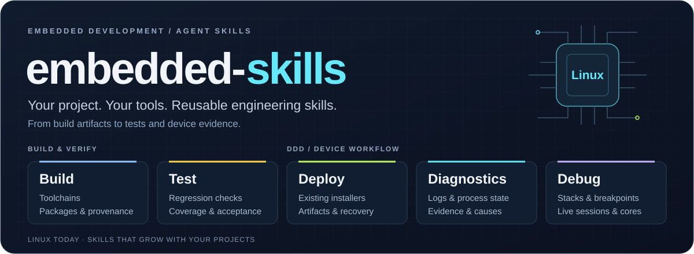

<p align="center">
  
</p>

<p align="center">
  <strong>Reusable skills for embedded development</strong><br>
  Build, test and work with devices using your project's tools.
</p>

<p align="center">
  <a href="README.zh-CN.md">中文</a> ·
  <a href="#quickstart">Quickstart</a> ·
  <a href="#skills">Skills</a> ·
  <a href="#the-ddd-loop">The DDD loop</a> ·
  <a href="INSTALL.md">Installation</a> ·
  <a href="LICENSE">MIT License</a>
</p>

**embedded-skills** is a collection of reusable embedded development skills for Codex. Describe the task in your project: build a package, verify a fix, deploy to a device, investigate logs or inspect a running program. The skills use the project's existing tools and keep evidence of what was built, executed and observed.

The current skills target **embedded Linux**. Build and test tasks can start on the development host; device tasks use the available SSH, Telnet or serial connection. RTOS and bare-metal support are future directions, not implemented capabilities.

## Skills

Install the collection or select the skills your project needs. Each skill has its own task boundary; using one does not require running all the others.

| Task | Purpose | Skill |
| --- | --- | --- |
| **Build** | Resolve toolchain and configuration, build through project entrypoints, and check final package contents | [embedded-linux-build](skills/embedded-linux-build/SKILL.md) |
| **Test** | Select host, emulation or device checks and distinguish executed behavior from pending acceptance | [embedded-linux-test](skills/embedded-linux-test/SKILL.md) |
| **Deploy** | Run the existing installer, observe before and after, and verify what actually runs | [embedded-linux-deploy](skills/embedded-linux-deploy/SKILL.md) |
| **Diagnostics** | Correlate serial, application and kernel logs with process state to locate the failure | [embedded-linux-diagnostics](skills/embedded-linux-diagnostics/SKILL.md) |
| **Debug** | Inspect stacks, breakpoints, program state or a core with GDB; verify recovery after a live session | [embedded-linux-debug](skills/embedded-linux-debug/SKILL.md) |

Build and Test are experimental additions. Their first [comparison](evals/README.md#recorded-comparison)
verified natural selection and correct task outcomes, but the comparison groups also
passed. An improvement in reliability or efficiency has not been established.

## The DDD loop

DDD stands for **Deploy, Diagnostics, Debug**, the collection's device workflow. Observe a deployment, use the evidence to narrow down a problem, then inspect the program where that evidence leads. Verify the fix on the device to complete the loop. Start with whichever stage your task needs.

The three skills share target details and evidence across the task. A missing serial log leads to other available log sources. A lost deployment connection calls for checking the device's actual state. A completed debug session includes checking that the process resumed.

Build and test skills also work independently of this loop. New skills are organized around recurring embedded development tasks; DDD does not define the limits of the collection.

## Quickstart

Paste this into Codex:

```text
Install embedded-skills from https://github.com/srymaker0/embedded_ddd
for Codex in this project. Follow INSTALL.md in the repository.
```

The five skill directories are installed directly in the project's `.agents/skills/`. You can also install them from the project directory with:

```sh
npx --yes skills add srymaker0/embedded_ddd --agent codex \
  --skill embedded-linux-build embedded-linux-test \
  embedded-linux-deploy embedded-linux-diagnostics embedded-linux-debug --copy --yes
```

Default installation adds only the five skill directories. They use your existing tools; install the optional helper when a device task needs it. To install a subset, keep only the desired names after `--skill`. [INSTALL.md](INSTALL.md) covers helper setup, updates and removal.

Then work in your application project:

```text
Build the package for the selected board and verify that it contains my library changes.
```

```text
Verify this fix with the relevant existing tests and identify what still needs a board test.
```

```text
Deploy this build to 192.0.2.10 and check its startup logs.
```

```text
The application keeps restarting. Use the serial and device logs to find out why.
```

```text
Use GDB to inspect the blocked threads, then detach and verify the process resumed.
```

Codex can select the relevant skill automatically. Invoke one directly with its name, for example `$embedded-linux-build`, `$embedded-linux-test` or `$embedded-linux-diagnostics`.

For a project's first device, ask: “Set up this Linux target using the project's connection details, check what diagnostics are available, and save a reusable local configuration.” The diagnostics skill includes [first-use guidance and connection templates](skills/embedded-linux-diagnostics/references/first-connection.md). The assistant reuses known details and asks for missing connection or project facts; an address alone cannot identify your installer or acceptance criteria.

## Work with your development environment

Use your existing SSH aliases, keys, terminal logs and deployment scripts. Device details can come from the conversation, project configuration or a private [connection profile](skills/embedded-linux-diagnostics/assets/profiles/).

Keep product-specific build commands, board layouts, configuration and acceptance criteria in the consuming project. The skills supply reusable methods for inspecting those facts and using the existing entrypoints. They do not require a particular build system, vendor SDK or application layout.

Linux debugging supports native GDB, host GDB with gdbserver, and offline cores. Live debugging pauses the selected process. Test results describe the environment that actually ran the checks; host or emulated results do not establish physical hardware behavior.

### Optional command-line tool

The optional `embedded-ddd` helper supports the DDD workflow with connections, transfers, log collection, deployment observation and native GDB snapshots on a Linux development host. Build and test skills use the project's own tools. Reuse a suitable installed helper or follow the [setup instructions](INSTALL.md#command-line-tool) when a device task needs capabilities that existing tools do not provide.

Copy an [SSH](skills/embedded-linux-diagnostics/assets/profiles/ssh.json), [Telnet](skills/embedded-linux-diagnostics/assets/profiles/telnet.json) or [serial](skills/embedded-linux-diagnostics/assets/profiles/serial.json) profile to a private path, replace the placeholders, then run from your application project:

```sh
.agents/skills/.embedded-ddd/bin/embedded-ddd --profile /path/to/board.json inspect
.agents/skills/.embedded-ddd/bin/embedded-ddd --profile /path/to/board.json inspect --local --for collect
.agents/skills/.embedded-ddd/bin/embedded-ddd --profile /path/to/board.json inspect --for collect
.agents/skills/.embedded-ddd/bin/embedded-ddd --profile /path/to/board.json collect --output output/logs-001 --duration 30
.agents/skills/.embedded-ddd/bin/embedded-ddd --profile /path/to/board.json deploy --output output/deploy-001
.agents/skills/.embedded-ddd/bin/embedded-ddd --profile /path/to/board.json gdb-snapshot --pid 1234 --output output/debug-001
```

Use a new output directory for each run. Profiles execute configured commands, so use trusted local configuration. Store credentials in SSH configuration or a separate private password file, and review collected logs before sharing.

Command access and file transfer are configured separately. Transfers support SFTP, SCP, SSH streams and HTTP uploads with SHA256 verification. Deployment uses the project's installer and its update and rollback behavior. Remote GDB and core analysis use standard debugger tools under skill guidance.

`inspect --for` checks the prerequisites for `connect`, `collect`, `put`, `deploy` or `gdb-snapshot` and returns JSON. A missing serial log is reported independently of an available application log. `--local` performs no target connection and leaves target readiness unknown. Inspection never runs an installer or attaches a debugger; its output lists the checks that still need a real operation.

## Try the DDD workflow

The [Linux lab](examples/README.md) builds a small application and starts a temporary SSH server on localhost. It deploys two versions through an example project installer, verifies hashes and heartbeats, injects a stalled worker, collects its application log despite a missing serial file, captures a GDB stack, and verifies recovery. It stops its application and server and removes its temporary keys afterward.

```sh
.venv/bin/python examples/linux_lab.py run --output output/linux-lab-001
```

Run this from a development checkout after the setup below. The example needs no physical board. Its results demonstrate Linux software behavior; real board architecture, serial wiring, watchdogs and firmware update behavior still require target validation.

## Development

From a checkout used to develop embedded-skills, create a virtual environment and run the helper's host tests:

```sh
python3 -m venv .venv
.venv/bin/python -m pip install --upgrade pip
.venv/bin/python -m pip install -e '.[console,serial]'
.venv/bin/python -m unittest discover -s tests -v
```

The full suite uses GCC, GDB, OpenSSH clients and server, a Telnet client, and curl. Missing optional tools are reported as skips. Tests cover connections, transfers, readiness checks, log continuity, deployment lifecycle and debugger recovery. CI also runs the complete localhost lab.

[Skill evaluations](evals/README.md) include four Linux device scenarios and three build/test comparison scenarios. The comparison prepares the same tasks with no project skills, three DDD skills, or all five skills. Preparation uses no model quota; explicitly running the full comparison starts nine Codex sessions. Checks inspect final package contents, whether regressions reject the old implementation, and unwanted execution during an explanation-only request. Host tests and CI do not invoke models; additional manual cases remain in the [scenario rubric](evals/scenarios.json).

In the [2026-10-29 comparison](evals/results/2026-10-29-comparison.json), all nine sessions passed automatic checks. Each group passed all three tasks, so this run does not demonstrate a benefit from the additional skills. All groups inherited the same global skills; this was not a skill-free model baseline. Manual review also found that the command explanations did not inspect the currently selected package library.

The [2026-10-29 evaluation](evals/results/2026-10-29.json) recorded three passes and one timeout for the three device skills at that revision. The first-connection behavior checks passed, but the session did not complete before its deadline and remains a failed case. That run predates the build and test skills and does not validate the expanded collection.

Contribute skills for recurring embedded tasks that need guidance beyond ordinary coding. State their supported environment, keep project-specific commands with the consuming project, and provide realistic evaluation scenarios. RTOS and bare-metal additions need their own tools, examples and validation evidence before being listed as supported.

Report problems or propose improvements through [GitHub Issues](https://github.com/srymaker0/embedded_ddd/issues) and pull requests. Include the host and target environment, reproduction steps, and relevant logs with private data removed.

## License

[MIT](LICENSE).
